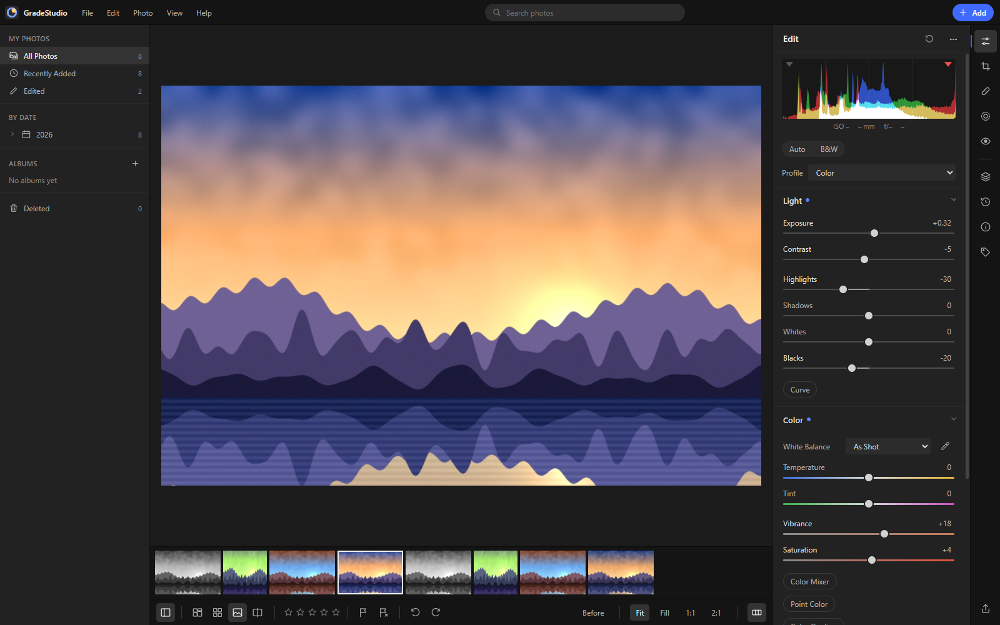
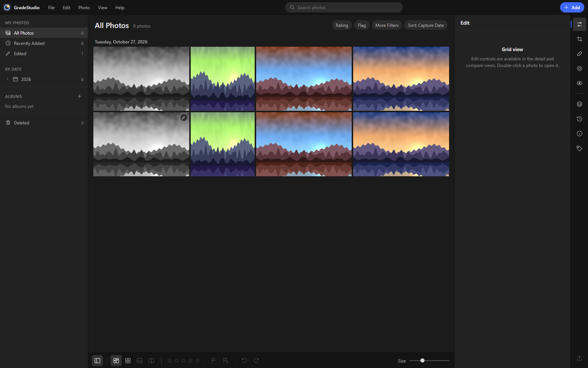
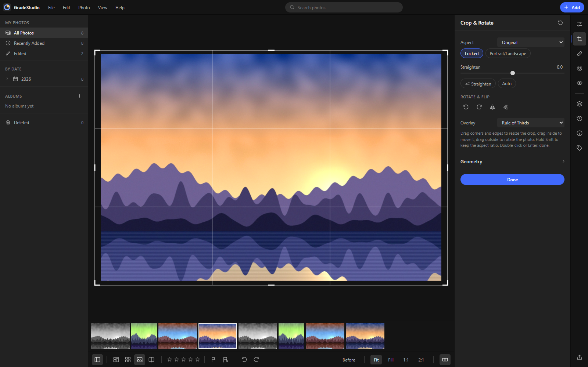

<div align="center">


# GradeStudio

**A fast, non-destructive photo editor and library that runs entirely on your own machine.**

No account. No subscription. No cloud. Your photos never leave your device.

[](LICENSE)




</div>

## Why GradeStudio?

Professional photo editing has drifted toward monthly fees, forced sign-ins and cloud sync. GradeStudio goes the other way:

- **Free and open source** (GPL-3.0). No trial, no paywall, no locked editing after a subscription ends.
- **Local-first.** Photos, edits, albums and presets live in your browser's IndexedDB (or in the desktop app's own data folder). Nothing is uploaded, ever. There is no telemetry.
- **Non-destructive.** The original file is never changed. Only edit settings are stored, so you can always go back.
- **GPU fast.** The whole pipeline runs in WebGL2, so sliders respond instantly, even on large photos.
- **On-device smarts.** Subject, sky, background and people masks run locally with a small open model. No AI service, no credits.

## Features

| Area | What you get |
| --- | --- |
| **Library** | Import files, folders or drag & drop. Photo and square grids, filmstrip, slideshow, albums, star ratings, flags, color labels, keywords, EXIF info, sorting, filters, search, trash |
| **Light** | Exposure, contrast, highlights, shadows, whites, blacks, parametric and point tone curve (RGB + R/G/B) |
| **Color** | White balance (with picker and auto), vibrance, saturation, 8-band color mixer, B&W mixer, point color, 3-way color grading, calibration |
| **Effects & Detail** | Texture, clarity, dehaze, vignette, film grain, sharpening, luminance and color noise reduction |
| **Optics & Geometry** | Chromatic aberration removal, defringe, lens correction, Upright (auto / level / vertical / full), manual perspective transform |
| **Lens Blur** | Depth-based bokeh with circle, bubble, blade, ring and cat-eye shapes |
| **Masking** | Brush, linear and radial gradients, color range, luminance range, plus on-device subject, sky, background and person-part masks. Add, subtract and intersect |
| **Retouch** | Content-aware remove, heal, clone, red-eye correction |
| **Looks** | 16 built-in profiles, 26 presets with adjustable amount, your own presets, named versions |
| **Crop** | Aspect ratios, auto-straighten, draw-a-line straighten, rotate, flip, composition overlays |
| **Export** | JPG, PNG, WebP, any size, output sharpening, watermark, batch export as ZIP |
| **Workflow** | Unlimited undo/redo, before/after compare, copy & paste settings between photos, clipping warnings, histogram |

<table>
  <tr>
    <td></td>
    <td></td>
  </tr>
  <tr>
    <td align="center">Library with grid, albums and filters</td>
    <td align="center">Crop, straighten and geometry</td>
  </tr>
</table>

## Quick start

You need [Node.js](https://nodejs.org) 20.19 or newer.

```bash
git clone https://github.com/canyando4699-pixel/GradeStudio.git
cd GradeStudio
npm install
npm run dev
```

Open the address Vite prints (usually <http://localhost:5173>) and drop some photos into the window. A few sample photos are in [`docs/sample`](docs/sample).

`npm install` also fetches the on-device masking model (16 MB, one time) and copies the MediaPipe runtime. Run `npm run setup` to repeat that step. The editor works without it; only the automatic masks need it.

### Desktop app (Windows)

```bash
npm run desktop
```

Builds GradeStudio as a standalone Electron app, installs it to `%LOCALAPPDATA%\Programs\GradeStudio` and adds Desktop and Start menu shortcuts. Your library lives in `%APPDATA%\GradeStudio`, separate from the browser version. `npm run app` starts the desktop shell without installing.

## Keyboard shortcuts

| Key | Action | Key | Action |
| --- | --- | --- | --- |
| `G` / `Shift+G` | Photo / square grid | `E` `C` `M` `H` | Edit, crop, masking, remove |
| `D` | Detail view | `W` | White balance picker |
| `Alt+C` | Compare before/after | `\` (hold) | Show original |
| `Shift+A` | Auto settings | `J` | Show clipping |
| `V` | Black & white | `0`-`5` | Star rating |
| `Ctrl+Z` / `Ctrl+Y` | Undo / redo | `Z` `X` `U` | Pick, reject, unflag |
| `Ctrl+C` / `Ctrl+V` | Copy / paste settings | `Ctrl+Shift+E` | Export |

Double-click any slider to reset it. Press `Ctrl+/` in the app for the full list.

## How it works

```
 photo file ──► analysis (edge-preserving base, detail bands, haze map)
                      │
 edit settings ───────┤   one WebGL2 pipeline, all sliders and masks per pixel
                      ▼
              develop ─► geometry & crop ─► vignette & grain ─► canvas / export
```

An edit is just a small JSON object (`Params`) stored next to the untouched original. Presets, versions and "copy settings" are subsets of that object. With default settings the output is pixel-identical to the input.

| Folder | Contents |
| --- | --- |
| `src/engine` | WebGL2 renderer and shaders, parameters, tone curves, analysis (auto tone, white balance, straighten, haze, CA), geometry, Upright, masks, retouch, profiles, presets, export |
| `src/ai` | On-device detection: MediaPipe segmentation, sky, content-aware remove (PatchMatch in a worker) |
| `src/store` | IndexedDB, library, editor history, UI state, masks, presets |
| `src/ui` | React interface |
| `electron` | Desktop shell and Windows packaging |

## Roadmap

- Raw file development (needs a raw decoder in the browser)
- Better depth model for lens blur and depth masks
- Upright with guide lines, targeted adjustment tool in the color mixer
- Smart albums, stacks, people grouping
- Export to TIFF/AVIF, color spaces, EXIF metadata
- macOS and Linux desktop builds

Ideas and pull requests are welcome. See [CONTRIBUTING.md](CONTRIBUTING.md).

## Credits & license

GradeStudio is free software, licensed under the **GNU General Public License v3.0**. See [LICENSE](LICENSE).

Built with [React](https://react.dev), [Vite](https://vite.dev), [Electron](https://www.electronjs.org) and [MediaPipe Tasks Vision](https://ai.google.dev/edge/mediapipe) (Apache-2.0). The selfie segmentation model is downloaded from Google's MediaPipe model storage on install. All shaders, algorithms, icons, profiles and presets in this repository are original work. The sample photos in `docs/sample` are synthetic images generated for this project.
